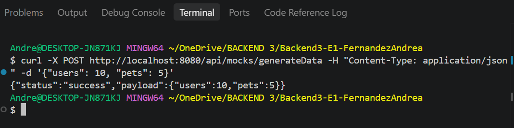
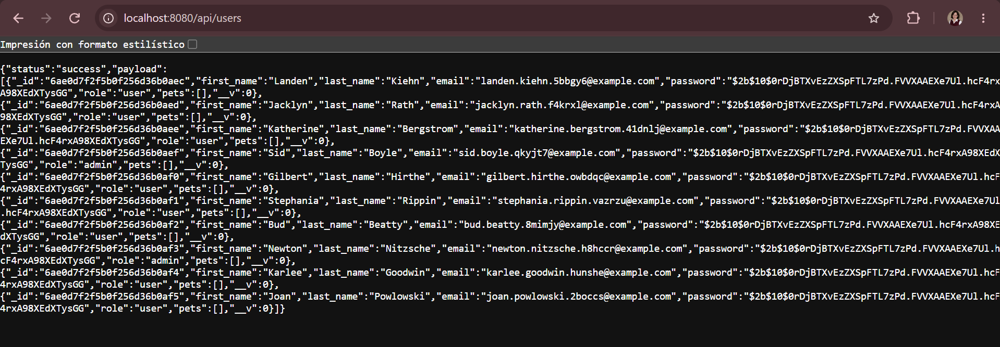
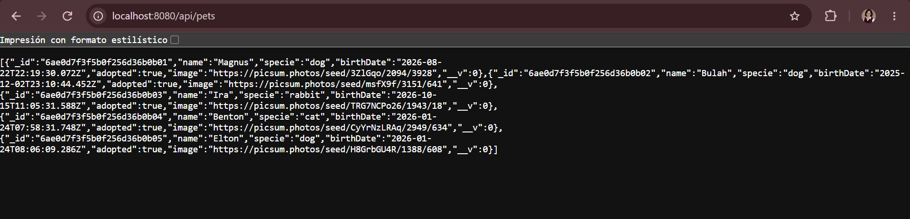
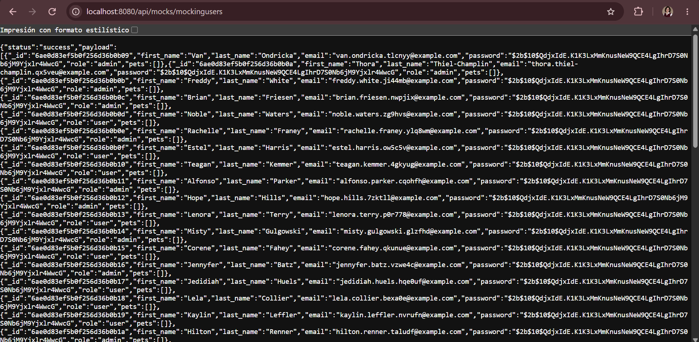
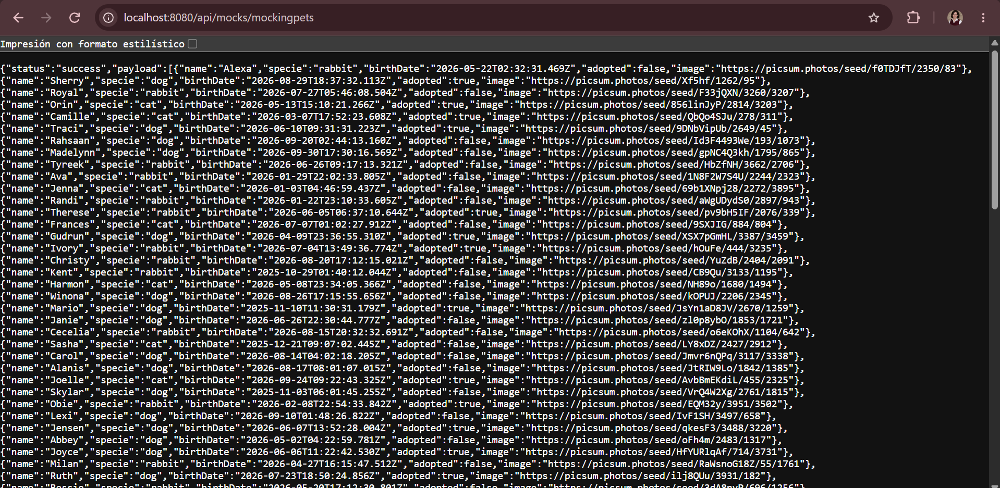

# Backend III - Entrega N°1: Mocks

Andrea Fernández

## Endpoints (base: /api/mocks)

- GET /api/mocks/mockingpets: genera 100 mascotas
- GET /api/mocks/mockingusers: genera 50 usuarios (password "coder123" encriptada, role user/admin, pets vacío)
- POST /api/mocks/generateData: recibe { "users": 10, "pets": 5 } e inserta esa cantidad en la base

## Capturas

### POST /generateData

### GET /api/users

### GET /api/pets

### GET /api/mocks/mockingusers

### GET /api/mocks/mockingpets

